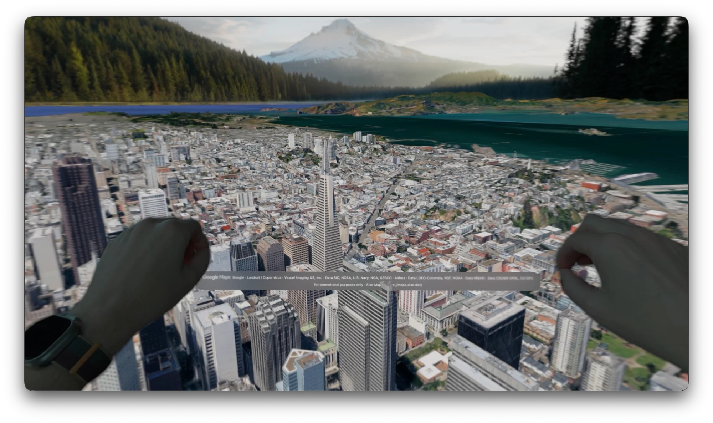

# Also Maps

Also Maps streams Google's Photorealistic 3D Tiles to Apple Vision Pro, in a volumetric window or an immersive space. There are also iPhone, iPad and Mac apps.

Tile selection and loading use [cesium-native](https://github.com/CesiumGS/cesium-native) via the Swift package [also/cesium-native-xcframework](https://github.com/also/cesium-native-xcframework), a fork of [crookneck/cesium-native-xcframework](https://github.com/crookneck/cesium-native-xcframework) that adds visionOS. RealityKit draws the tiles.



## Setup

You need Xcode 26 or later with the platform SDKs you want to build for, and [XcodeGen](https://github.com/yonaskolb/XcodeGen) (`brew install xcodegen`). The Xcode project is generated, not checked in. All builds are Apple silicon (arm64) only.

1. **Generate the project and open it.**

   ```
   xcodegen generate
   open AlsoMaps.xcodeproj
   ```

2. **Pick a scheme and run it.** There's a scheme for each platform (Also Maps visionOS, iOS and macOS), each needing OS 26 or later.

   On a Vision Pro, run the **Also Maps visionOS (Optimized)** scheme unless you're debugging. It's the Debug build (the key from `Config/Secrets.xcconfig`, `DEBUG` code and logging) compiled with optimization, and without Metal API validation or GPU frame capture. The unoptimized Debug build misses frame deadlines on the device. The debugger still attaches, but stepping through optimized code is less reliable.

3. **Add your own Google Maps key.** On first launch the app asks how to load the map. Builds from source can't use the app's shared key, because that is only handed to builds that pass App Attest as the published app (see [Keys](#keys)). Choose your own key and paste a Google Maps Platform API key with the Map Tiles API enabled. It's saved in the Keychain, so you enter it once per device. If you restrict the key to iOS apps, use your build's bundle ID: the app sends it as `X-Ios-Bundle-Identifier` on every platform.

   You can also build a key into Debug builds instead of entering it: copy `Config/Secrets.example.xcconfig` to `Config/Secrets.xcconfig` and set `GOOGLE_MAPS_API_KEY`, or set `GOOGLE_MAPS_API_KEY` in the scheme's environment.

**Running on a device.** The simulators need no signing. For a device, set `DEVELOPMENT_TEAM` in `Config/Secrets.xcconfig`, so signing survives regenerating the project. Debug builds have no capabilities that need their own App ID, so Xcode signs them with your team's wildcard profile and the bundle ID can stay as it is.

**No key?** Tick the `ALSOMAPS_*` variables in the visionOS scheme. They stream a public Cesium sample tileset instead. `ALSOMAPS_LAT`, `ALSOMAPS_LON`, `ALSOMAPS_RADIUS` and `ALSOMAPS_HEADING` also work on their own, to start somewhere other than the Ferry Building.

**Optional Cesium ion token:** to use the Cesium ion tile sources, add `CESIUM_ION_TOKEN` to `Config/Secrets.xcconfig`. Create the token with only the `assets:read` scope, restricted to the assets the app uses (1, Cesium World Terrain, and 96188, Cesium OSM Buildings).

**Optional soundtrack:** put an MP3 at `Local/soundtrack.mp3`. `Local/` is gitignored, for assets that can't be published. If the file is there, the build bundles it and the app loops it quietly while active, with a mute button in the ornament. Without it, the app simply has no soundtrack.

## How it fits together

cesium-native decides which tiles to load and fetches them; a thin bridge hands them to RealityKit; a platform-neutral navigation core owns the camera, and each platform presents that camera its own way.

- **Streaming.** `Sources/Cesium/CNTileStreamer.{h,mm}` is an Objective-C++ bridge that owns a cesium-native `Tileset`. It supplies networking over `NSURLSession` (cesium-native is built without curl) and a GCD task processor, and flattens each tile's glTF into float positions relative to the tile's own center, plus UVs, indices and RGBA. Every frame, each drawn tile gets a transform, computed in double, that places it relative to the current anchor. There's no global origin, so precision is the same anywhere on Earth. An excluder limits streaming to the area of interest, a square around the anchor, and level of detail comes from a camera given in the anchor's frame.
- **Frames.** `Sources/TileStreaming.swift` runs one cesium-native update per frame from those inputs (anchor, area of interest, LOD camera), adds ready tiles, hides tiles that aren't selected and removes freed ones. `Sources/TileUploader.swift` builds each tile's RealityKit meshes and textures off the main thread, a few at a time, before cesium-native counts the tile as loaded.
- **Navigation.** `Sources/Navigation/` holds WGS84 geodesy and surface queries, the camera pose and navigation state, the georeference (world to map frame), the streaming inputs and the control styles. It doesn't depend on RealityKit or a platform, and `Also Maps Core Tests` covers it on macOS. See [Tests](#tests), and [docs/fundamentals.md](docs/fundamentals.md) for the ideas behind scale and placement.
- **Presentation.**
  - *Volume* (`Sources/MapModel.swift`, `Sources/VolumeView.swift`): the world is scaled so the camera sits at a design eye point and what it looks at sits low in the volume. The Shared Space gives the app no head pose, so a synthetic camera in front of the volume, 45° up, drives level of detail.
  - *Immersive* (`Sources/ImmersiveMapView.swift`, `Sources/Navigation/EyeLevelModel.swift`): the camera is at your eye and the map is level on the floor, scaled so the camera's height above the ground is your eye's height above the floor. Far up, the map tilts about your eye, so the ground comes up in front of you as a globe.
  - *iPhone, iPad and Mac* (`Sources/Screen/ScreenMap.swift`): the window's camera is the navigation camera.

  Tiles are placed relative to whichever anchor is streaming, so held tiles stay put while you move.
- **Metal renderer.** `Sources/Metal/` and `Sources/MetalImmersiveSpace.swift` are an experimental alternative to RealityKit, behind Settings › General › Draw with Metal. See [notes/metal-renderer.md](notes/metal-renderer.md).
- **App services.** `Sources/Credentials/` ([Keys](#keys)), `Sources/Config/` ([docs/remote-config.md](docs/remote-config.md)), `Sources/Places/` ([Places](#places)) and `Sources/Tracks/` (recording the camera's path to a CSV in the app's Documents folder, and playing it back).

## Views

The picker under the volume switches between the volume and **Immersive**. Immersive opens an immersive space and lays the map level on its origin plane, the floor where you stood when it opened, all around you, with the camera at your eye. The map's center point, 5.6 m ahead, is where places are framed. Far up, the map tilts about your eye into a globe in front of you. The space is mixed (passthrough) unless **Full immersion** is on in Settings. The volume stays open as the control panel, and an attribution panel sits at the map's near edge. If a system environment (Mount Hood, the Moon and so on) is active, mixed Immersive keeps it, with the map on its ground. If you close the volume while in Immersive, that panel shows **Show Controls** to bring it back. Opening the app from the Home View always reopens the volume.

`ALSOMAPS_PRESENTATION=immersive` (or `volume`) starts in that mode.

Immersive doesn't clip the map's edges the way the volume does, so whole tiles stick out past the region (#5).

## Controls

- **Pan:** look at the map, pinch and drag. Gestures are indirect only (look and pinch), so open hands over the map do nothing.
- **Zoom:** pinch with both hands and move them apart or together. The view's half-width ranges from 50 m to 10,000 km, about a hemisphere. Below 50 km the ground is placed by sampling terrain. Above 50 km it's placed by the Earth's curve, so sea level at the view's edges meets the base plane, with no sampling. At hemisphere scale, tiles on the far side of the Earth are skipped.
- **Turn:** pinch with both hands and twist about the vertical. The map turns around the focus point and can turn while zooming.
- **Hardware keyboard:** WASD or the arrow keys move relative to where you're facing, Q and E turn, R and F descend and climb (which is zoom), `=` and `-` zoom, and holding Shift goes three times faster. The ornament shows these hints while a keyboard is connected.
- **Game controller** (Xbox-style): the left stick moves. The right stick turns (left/right) and changes altitude (up climbs, which zooms out; down descends). Both sticks are analog with a dead zone. RT and LT also zoom in and out. Hold LB, or click the left stick, to go faster. D-pad left and right step through places, Y faces north, and X holds or releases the loaded tiles (see [Holding tiles](#holding-tiles)). The ornament shows these hints while a controller is connected. Keyboard and controller input combine.

On a Mac, the map also takes the usual mouse and trackpad controls:

- **Pan:** click and drag, and let go while moving to flick the map on. Two-finger scrolling on a trackpad or Magic Mouse pans too.
- **Zoom:** pinch, turn a mouse wheel, or hold Option and scroll, all about the pointer. Double-click zooms in, Option-double-click zooms out, and a two-finger double tap on a trackpad zooms in.
- **Turn and tilt:** right-drag, or hold Option or Control and drag: sideways turns, up and down tilts. A two-finger twist on a trackpad turns, and Shift-scroll tilts.

On iPhone and iPad, drag to pan, pinch to zoom, twist to turn and move two fingers up or down to tilt. Double tap zooms in (hold the second tap and drag to keep zooming) and a two-finger tap zooms out. Two on-screen sticks, laid out like a game controller's, move and turn or climb, with a tilt slider between them. Places and Settings are in the navigation bar.

`ALSOMAPS_HEADING`, in degrees clockwise from north, sets the starting direction.

## Holding tiles

**Hold tiles**, in the debug panel, or X on a controller, freezes streaming, so the loaded tiles stay as they are. Every control then does exactly what it does with live tiles: the same moves, turns and zoom and at the same rates, applied to the frozen scene instead of the live map. The surface stays on the base plane. Releasing the tiles resumes streaming from where you are, without anything visibly moving. While tiles are held and the debug panel is closed, the toolbar shows a Tiles Held button that releases them.

Detail doesn't improve as you zoom in, because nothing new loads while frozen. You can travel about 1.5× and zoom out about 3× the held region before stopping. Changing view mode or going to a place releases the tiles.

The debug panel opens from the wrench in the toolbar, which shows when Settings → Advanced → Debugging has **Show debug controls** on. It also has the debugging overlays and view-state copy and restore, the same controls as that Settings page.

## Places

The pin button next to the mode picker jumps to a saved place: its position, zoom and facing. The defaults are in `Sources/Places/Places.json` (San Francisco, Boston, New York, Chicago, Grand Canyon and Puente Nuevo in Ronda). Each entry has an `id`, `name`, `latitude`, `longitude`, `radius` (view half-width in meters) and an optional `heading` (degrees clockwise from north). `PlaceLibrary` is where user-added places, stored locally or in iCloud, would be merged in later. `ALSOMAPS_PLACE=<id>` starts at that place.

The remote config can replace these defaults; see [docs/remote-config.md](docs/remote-config.md).

## Keys

Release builds contain no keys, except on tvOS. Where there's no key yet, the first launch asks how to load the map: with the app's shared key, which may be throttled, or with your own. Change it later in Keys (in Settings on every platform but tvOS). `Sources/Credentials/` holds this.

- **The app's key** comes from the app's credentials API, which needs App Attest, so `AppKeyClient` proves the app is genuine, saves what it gets in the Keychain and refreshes it daily. Where `isSupported` is false, the app offers only your own key: macOS 26, and simulators. The Mac needs macOS 27 or later, where the API also requires Apple's key policy (full security mode and System Integrity Protection). Refreshes run only while a window is active. The app needs App Attest, from `Config/AppAttest.entitlements`, which needs an explicit App ID on the maintainer's team. Release builds always have it. Debug and Optimized builds have it only when `Config/Secrets.xcconfig` sets `DEBUG_CODE_SIGN_ENTITLEMENTS = Config/AppAttest.entitlements`, so anyone else's team can sign them with its wildcard profile.
- **Your own key** is saved in the Keychain, and follows you between devices through iCloud Keychain. Saving one makes one request to check it, which for Google counts as a map session.
- **Which wins**: a scheme's `GOOGLE_MAPS_API_KEY` or `CESIUM_ION_TOKEN`, then your own, then the app's, then one built in from `Config/Secrets.xcconfig` (Debug builds, and tvOS). `ALSOMAPS_CREDENTIALS_URL=<url>` points at another deployment of the API.
- **Rotation**: streaming restarts whenever the key changes. When a service rejects the app's key, the app fetches a new one straight away, so an old key can be deleted at any time.

## Google Maps Platform terms

Whoever owns the Google Maps Platform key a build uses must follow the [Google Maps Platform Terms of Service](https://cloud.google.com/maps-platform/terms) and the [Map Tiles API policies](https://developers.google.com/maps/documentation/tile/policies). That's the maintainer for builds on the app's key, and you for builds on your own key. In particular:

- **Terms notice**: the app's terms must say it includes Google Maps features and content. They must also say that use is subject to the [Google Maps/Google Earth Additional Terms of Service](https://maps.google.com/help/terms_maps/) and the [Google Privacy Policy](https://policies.google.com/privacy) (§3.2.2(a)). For this app, that's the [Terms of Use](https://maps.also.dev/terms/), linked from General in Settings. If you distribute your own build, point `SettingsView.termsURL` at your own terms.
- **Attribution**: keep the Google Maps logo and the tile attributions visible.
- **No storing or exporting** tile content, or data derived from it such as surface heights, beyond what the HTTP cache headers allow.
- **Videos**: only promotional videos about the app, 30 seconds or less, marked "for promotional purposes only", with the attribution showing.

## Settings

Settings is a window on visionOS and a sheet on iPhone and iPad, each opened with the gear button (on visionOS, next to the mode picker). On the Mac it's the standard Settings window (⌘,). Categories are in a sidebar. Changes apply immediately and are remembered between launches. visionOS has every category; the others have General, Keys and Advanced.

**General**
- **Tiles** picks the source: Google Photorealistic, or Cesium OSM Buildings or Cesium World Terrain via Cesium ion. The ion sources are untextured, so they're drawn lit. Buildings use their own normals, or flat normals computed per triangle. Terrain uses smooth normals generated by cesium-native, in a flat earth tone until imagery overlays arrive (#8). Switching restarts streaming at the same view. Credits that carry a logo, such as Cesium ion's, show it in the attribution panel.
- **Show stats** adds tiles drawn, entities, load progress and request counts to the panel over the map: the ornament on visionOS, the top-left overlay on iPhone and the Mac (which adds fps and the camera's position). Keyboard and controller hints show there whether or not stats are on.
- **Draw with Metal** draws the map with the app's own experimental Metal renderer instead of RealityKit. On visionOS it applies to Immersive, always in full immersion, from the next time it opens; pinching the map isn't available there. Tracks and tile bounds aren't drawn with it. See [notes/metal-renderer.md](notes/metal-renderer.md).
- **Terms** links the app's [Terms of Use](https://maps.also.dev/terms/), the Google Maps/Google Earth Additional Terms of Service and the Google Privacy Policy. See [Google Maps Platform terms](#google-maps-platform-terms).

**Immersion** (visionOS): **Full immersion**, **Human scale (test)**, and
- **Limit reach** (Immersive only): by default Immersive streams everything you could see, all around you out to the horizon (plus ~200 km for mountains beyond it), measured from where your eye is in the world, so a tilted globe shows its whole visible face. Turn this on to stream only **Reach** around you instead: 5× to 100× your height above the ground (the same multiple of your eye height above the floor).

**Detail** (visionOS): cesium-native's screen-space error thresholds, for tiles inside and outside the LOD camera's view. Most of the area of interest is outside that view, so Outer detail controls how sharp the far map is and how many tiles it costs. On iPhone and the Mac, detail is set from the window's pixels instead.

**Keys**: see [Keys](#keys).

**Advanced**
- **Parallel uploads, Simultaneous loads, Cache, Forbid holes**: trade-offs between fill speed, memory and gaps while refining. Forbid holes is on by default: a tile counts as loaded only once it's drawable, so parents stay until all their children can replace them.
- **Reset to Defaults** returns everything but Show stats and keys to the hand-tuned baseline in `StreamingSettings.default`.

`ALSOMAPS_OPEN_SETTINGS=1` opens the window at launch on visionOS.

**Debugging** (Advanced, visionOS): **Show debug controls** adds the wrench that opens these controls in a panel beside the map. The same controls are on this page:
- **Hold tiles**: see [Holding tiles](#holding-tiles).
- **Pivot and center markers** draws a red post where turns and zooms pivot, and a blue post at the map's center.
- **Tile bounds** draws each drawn tile's box, cyan inside the LOD camera's view and orange outside, with the area of interest in yellow and the LOD camera's view in pink.
- **Copy View State** copies the whole view as JSON (position, zoom, heading, presentation, held tiles and settings) and prints it to the console.
- **Restore from Clipboard** brings a copied state back.

At launch, `ALSOMAPS_STATE=<that JSON>` restores a state and `ALSOMAPS_MARKERS=1` shows the markers and `ALSOMAPS_TILE_BOUNDS=1` the tile bounds.

## Tests

`Also Maps Core Tests` tests the navigation core on macOS, without a scene or network:

```
xcodebuild -scheme 'Also Maps Core Tests' -destination 'platform=macOS' test
```

## Running and inspecting the Mac app (for tools and agents)

The macOS target's **Debug** build is unsandboxed (`SourcesMac/AlsoMapsMac.Debug.entitlements`: network client only), so you can launch the binary directly, pass `ALSOMAPS_*` variables, capture its stdout, and read its on-disk state. **Release** keeps the sandbox (`SourcesMac/AlsoMapsMac.entitlements`). The sandboxed build keeps its files in `~/Library/Containers/dev.also.maps/`, which the shell can't list ("Operation not permitted").

```
xcodebuild -scheme "Also Maps macOS" -configuration Debug -destination 'platform=macOS' -derivedDataPath build build
ALSOMAPS_LAT=37.7955 ALSOMAPS_LON=-122.3937 ALSOMAPS_RADIUS=800 \
  "build/Build/Products/Debug/Also Maps.app/Contents/MacOS/Also Maps" > run.log 2>&1 &
```

It needs a logged-in macOS session, since it opens a window. Kill it by PID when done. The API key comes from `Config/Secrets.xcconfig` via Info.plist, or from `GOOGLE_MAPS_API_KEY` in the environment.

Where things land when unsandboxed:
- **HTTP cache**: `~/Library/Caches/dev.also.maps/tiles/`. Delete it for a cold run. See [docs/tile-caching.md](docs/tile-caching.md).
- **Defaults**: `~/Library/Preferences/dev.also.maps.plist`.

Timing the tile pipeline with signposts and `xctrace` is in [docs/profiling.md](docs/profiling.md). Tile caching, the request counters in the Tuning stats, and how to measure them are in [docs/tile-caching.md](docs/tile-caching.md).

## Known gaps

- The main thread still spends 2–3 ms per frame on tile selection and on re-placing every tile, even when the view isn't moving (#2).
- Below 50 km, ground height is the lowest hit on a 3×3 grid of samples. In a region that's mostly hills with a little low ground, the hills can reach close to the top of the volume.

## tvOS proof of concept

The `Also Maps tvOS` target (tvOS 26+) exists to show that rendering works on Apple TV. It shows a full-screen, static view of a bundled place, looking down at 45°, and the location button in the upper right picks another place. There's no free navigation. It uses the key from `Config/Secrets.xcconfig` (or the app's key), not one entered in the app.

It shares `Sources/Static/StaticMapView.swift` with the rest of the streaming pipeline. `ALSOMAPS_PLACE=<id>` picks the starting place, and `ALSOMAPS_VIEW=bay` a wider camera preset; `ALSOMAPS_RADIUS` overrides a preset's area.
