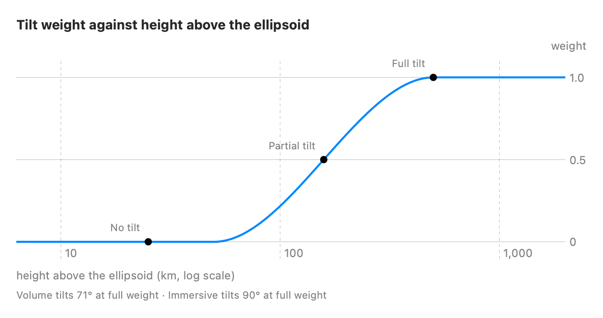
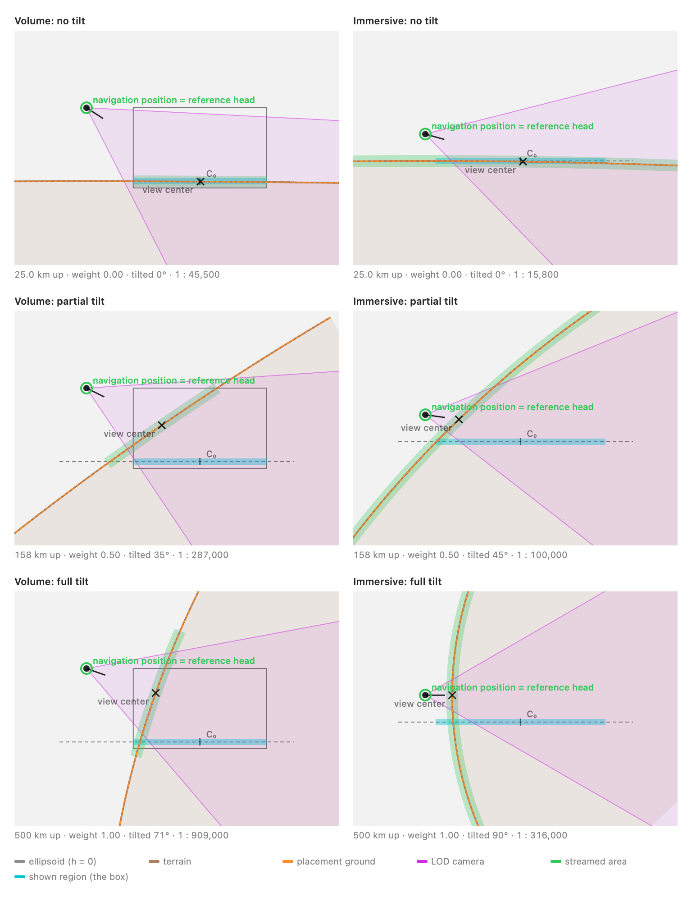

# Tilt assist

In the volume and the immersive space, the world is level near the ground. Higher up, the tilt assist turns it toward you, so the ground below comes up in front of you, like looking down at a globe.

This page shows what the code does now. It doesn't say what the assist should do. The figures and their numbers are generated from the code (see [Regenerating](#regenerating)). When the behavior changes, regenerate them and fix any text that no longer matches. Terms such as *navigation position* and *reference head pose* are as in [fundamentals.md](../fundamentals.md#easily-misused-terms).

## How much it tilts

The assist sets a weight from 0 (level) to 1 (full tilt), from the navigation position's height above the ellipsoid alone ([`EyeLevelModel.tiltWeight`](../../Sources/Navigation/EyeLevelModel.swift)). The ground estimate and the pitch play no part. Each host decides how far full weight turns the world ([`RoomGeometry.fullTilt`](../../Sources/Navigation/HostGeometry.swift), set in [`MapPresentation.geometry`](../../Sources/MapPresentation.swift)).



The three dots are the heights the next figure uses: half the height where the tilt starts, where the weight is 0.5, and where it reaches 1.

## What it looks like

Each panel is a host's room seen from the side, with you on the left looking right. The world is placed by [`EyeLevelModel.framing`](../../Sources/Navigation/EyeLevelModel.swift), the same function the app uses.



How to read it:

- **The ring** is the reference head pose. In both hosts the navigation position is placed there, and the tilt turns the world about it, so it stays put. The figures use each host's assumed pose; the immersive space measures it when it opens.
- **The dashed line** is the base plane: the floor in the immersive space, low in the box in the volume. **C₀** is where the view center sits while the world is level.
- **Orange** is the placement ground, the ground estimate the scale is set from. Level, it lies on the base plane. The terrain is drawn too, at the same height here.
- **The cross** is the view center, which gestures grab, streaming centers on and zoom holds in place. In both hosts it's the ground along a line of sight from your eye ([`RoomGeometry.sightLine`](../../Sources/Navigation/HostGeometry.swift)). Level, the line points at C₀. As the tilt grows it turns evenly toward where full tilt puts the ground below the navigation position: the box's center in the volume, which keeps the view center in the box, and straight ahead in the immersive space. At full tilt the view center is the ground below the navigation position.
- **The box** (volume only) is the volume's bounds. **Teal** is the content square on the base plane: what the box shows, or in the immersive space, the area for gestures and the ground sample.
- **Purple** is the LOD camera streaming uses, and **green** the streamed area, with the default streaming settings.

The scale comes from the navigation position's height above the placement ground, and the tilt doesn't change it.

## Live

The Mac app's camera diagram (⌥⌘D) draws the same views for any position. Choose **Volume** or **Immersive**, then **Climb** or **Descend** to watch the tilt change.

## Regenerating

From the repository root:

```bash
swiftc -O -parse-as-library -o /tmp/tilt-figures Sources/Navigation/*.swift Sources/MapPresentation.swift Sources/StreamingSettings.swift Sources/TileSource.swift Sources/Diagrams/CameraDiagramView.swift docs/tilt-assist/make-figures.swift
```

```bash
/tmp/tilt-figures docs/tilt-assist/figures
```

[make-figures.swift](make-figures.swift) finds the three heights from `EyeLevelModel.tiltWeight` and takes each host's geometry and streaming policy (with the default settings) from `MapPresentation`, so it needs no changes when those do.
